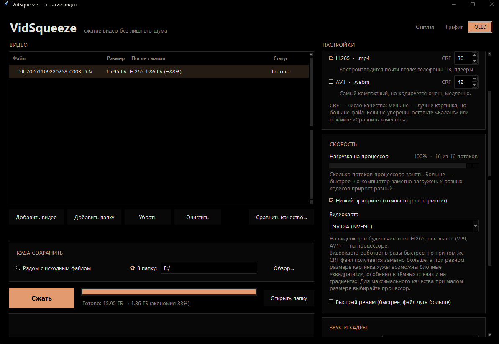

# VidSqueeze

Программа для сжатия видео на Windows. Перетащите файлы в окно, выберите качество и нажмите «Сжать». Размер результата видно до начала сжатия.



## Скачать и сразу пользоваться

1. Скачайте [VidSqueeze-win64.zip](https://github.com/DomenicoCano/VidSqueeze/releases/latest/download/VidSqueeze-win64.zip) из раздела [Releases](https://github.com/DomenicoCano/VidSqueeze/releases).
2. Распакуйте архив в любую папку.
3. Запустите `VidSqueeze\VidSqueeze.exe`.

Ничего устанавливать не нужно: Python и FFmpeg уже внутри.

## Возможности

- **Три кодека:** VP9 (`.webm`), H.265 (`.mp4`) и AV1 (`.webm`).
- **Перетаскивание и пакетная обработка:** можно бросить сразу несколько файлов или целую папку с подпапками.
- **Оценка размера заранее:** программа кодирует три коротких фрагмента нужными настройками и пересчитывает итоговый размер. На тестах погрешность была 3–11%.
- **Сравнение качества:** подбирает формат и CRF по SSIM и показывает, какой вариант даёт минимальный размер при заданном качестве.
- **Нагрузка на процессор:** можно ограничить число потоков и понизить приоритет процесса, чтобы компьютер не тормозил.
- **Кодирование на видеокарте:** NVIDIA, Intel и AMD. Работоспособность проверяется пробным кодированием. Аппаратное кодирование быстрее, но при том же CRF файл обычно больше.
- **Звук и кадры:** звук удаляется, если его нет или он практически беззвучен. Частота кадров ограничивается 30 fps (можно отключить).
- **Три темы оформления:** «Светлая», «Графит» и «OLED».
- **Командная строка:** те же функции доступны из консоли (`compress`, `compare`, `info`).

FFmpeg встроен через `imageio-ffmpeg`, отдельно его ставить не нужно. Если в системе уже есть свой `ffmpeg`, программа использует его.

Работает на Windows. Для запуска из исходников нужен Python 3.10 или новее.

## Установка и запуск

**Из исходников:**

```powershell
python -m venv .venv
.\.venv\Scripts\python -m pip install -e .
.\.venv\Scripts\python VidSqueeze.pyw
```

Двойной щелчок по `VidSqueeze.pyw` тоже запускает окно, без консоли.

**Готовая сборка `VidSqueeze.exe`** через PyInstaller:

```powershell
.\.venv\Scripts\python -m PyInstaller --noconfirm --windowed --name VidSqueeze `
  --collect-all imageio_ffmpeg --collect-all tkinterdnd2 --distpath dist --workpath build --specpath build VidSqueeze.pyw
```

Результат появится в папке `dist\VidSqueeze`. Её можно отправить архивом: FFmpeg уже внутри.

## Командная строка

```powershell
# сжать файл (по умолчанию VP9 и H.265 рядом с исходником)
python -m vidsqueeze compress video.mp4

# папка с подпапками, только H.265, результат в другую папку
python -m vidsqueeze compress C:\Videos -r -c h265 -o C:\Videos\small

# свой CRF, AV1, быстрый режим
python -m vidsqueeze compress video.mp4 -c av1 --crf-av1 38 --fast

# сравнить кодеки и CRF на трёх 1-секундных фрагментах (SSIM и оценка размера)
python -m vidsqueeze compare video.mp4 --candidates vp9:36,42,48 h265:24,30,36

# сведения о файле
python -m vidsqueeze info video.mp4
```

## Что делает по умолчанию

- VP9 с CRF 42 (`.webm`), H.265 с CRF 30 (`.mp4`), AV1 с CRF 42 по запросу.
- Звук удаляется, если его нет или пик не выше −50 dBFS (`--audio keep|drop|auto`).
- Частота кадров ограничивается 30 fps (`--max-fps 0` отключает), нечётные размеры исправляются.
- 8-битное видео `yuv420p` (`--ten-bit` включает 10-бит).
- Существующие файлы не перезаписываются. Файлы с суффиксами `-vp9`, `-h265`, `-av1` при пакетной обработке пропускаются, чтобы результат не пережимался повторно.

Примечание: во встроенной сборке FFmpeg нет SVT-AV1, поэтому AV1 кодируется через libaom. Это заметно медленнее.

## Структура проекта

- `vidsqueeze/ffmpeg.py` — поиск и запуск FFmpeg, разбор прогресса.
- `vidsqueeze/codecs.py` — профили кодеков и аргументы кодера.
- `vidsqueeze/compress.py` — сжатие пакетом, фильтры, работа со звуком.
- `vidsqueeze/estimate.py` — оценка размера до сжатия.
- `vidsqueeze/compare.py` — сравнение качества (SSIM) и фронт Парето.
- `vidsqueeze/hardware.py` — определение кодеров видеокарты.
- `vidsqueeze/gui.py`, `vidsqueeze/theme.py` — окно и темы.
- `vidsqueeze/cli.py` — командная строка.

## Благодарности

Рецепты кодеков, значения CRF, логика обработки звука и сравнения качества перенесены из скилла **[compress-video](https://github.com/pixel-point/skills)** репозитория [pixel-point/skills](https://github.com/pixel-point/skills), лицензия MIT. Спасибо авторам за продуманные настройки, без которых этой программы бы не было.

Спасибо также проектам, на которых всё держится: [FFmpeg](https://ffmpeg.org/), [imageio-ffmpeg](https://github.com/imageio/imageio-ffmpeg) и [tkinterdnd2](https://github.com/pmgagne/tkinterdnd2).

## Лицензия

MIT. См. файл [LICENSE](LICENSE).
